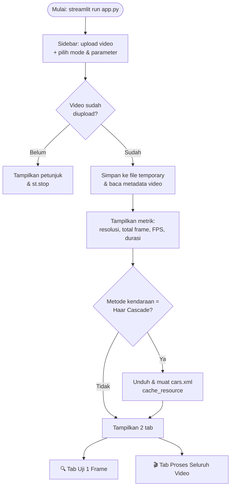
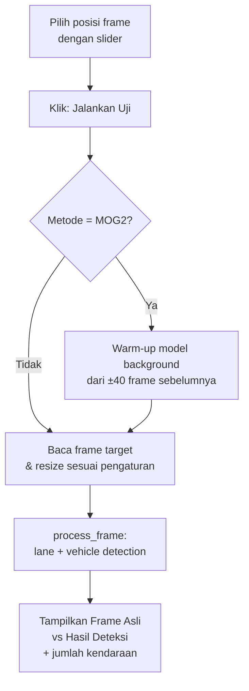
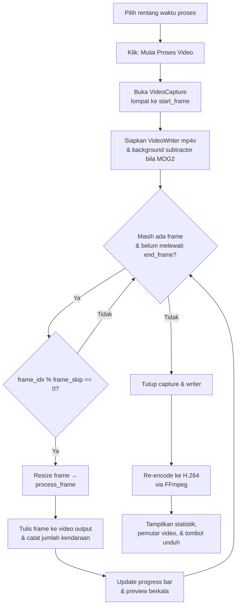
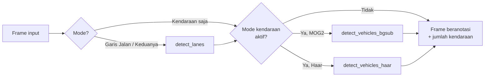
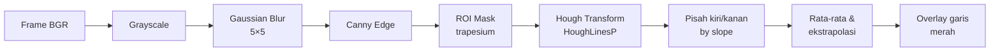
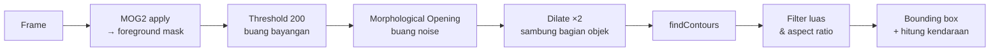
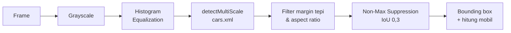

# 🚗 Deteksi Kendaraan & Garis Jalan (OpenCV + Streamlit)

Aplikasi web berbasis **Streamlit** untuk mendeteksi **garis jalan (lane detection)** dan **kendaraan** pada video jalan raya menggunakan pipeline *computer vision* klasik dari **OpenCV** — tanpa deep learning, tanpa GPU.

---

## 📑 Daftar Isi

1. [Fitur Utama](#-fitur-utama)
2. [Demo Singkat Penggunaan](#-demo-singkat-penggunaan)
3. [Instalasi & Menjalankan](#-instalasi--menjalankan)
4. [Workflow Aplikasi](#-workflow-aplikasi)
5. [Algoritma yang Digunakan](#-algoritma-yang-digunakan)
6. [Parameter di Sidebar](#-parameter-di-sidebar)
7. [Struktur Kode](#-struktur-kode)
8. [Tips Tuning & Performa](#-tips-tuning--performa)
9. [Keterbatasan](#-keterbatasan)
10. [Teknologi](#-teknologi)

---

## ✨ Fitur Utama

- **Upload video** jalan raya (`mp4`, `avi`, `mov`, `mkv`).
- **Deteksi garis jalan**: Grayscale → Gaussian Blur → Canny → ROI mask → Hough Transform → rata-rata garis kiri/kanan.
- **Deteksi kendaraan** dengan dua pilihan metode:
  - **Background Subtraction (MOG2)** — cocok untuk kamera statis / CCTV.
  - **Haar Cascade** — cocok untuk kamera bergerak / dashcam.
- **Tiga mode**: Garis Jalan saja, Kendaraan saja, atau Keduanya.
- **Mode "Uji 1 Frame"** untuk *tuning* parameter secara instan sebelum memproses seluruh video.
- **Proses full video** dengan progress bar, preview langsung, statistik jumlah kendaraan, pemutar video, dan tombol unduh hasil.
- **Opsi performa**: resize lebar frame, skip frame, dan pemilihan rentang waktu yang diproses.

---

## 🎬 Demo Singkat Penggunaan

1. Jalankan aplikasi, lalu **upload video** dari sidebar.
2. Pilih **mode deteksi** dan **metode deteksi kendaraan**.
3. Buka tab **🔍 Uji 1 Frame**, geser slider posisi frame, klik **Jalankan Uji**, dan atur parameter sampai hasil pas.
4. Buka tab **🎬 Proses Seluruh Video**, pilih rentang waktu, klik **Mulai Proses Video**.
5. Tonton hasilnya dan **unduh** `hasil_deteksi.mp4`.

---

## 🛠️ Instalasi & Menjalankan

### Prasyarat

- Python 3.9+
- **FFmpeg** terpasang di sistem (dipakai untuk re-encode hasil video ke H.264 agar bisa diputar di browser)
- Koneksi internet saat pertama kali memakai Haar Cascade (file `cars.xml` diunduh otomatis)

### Langkah

```bash
# 1. Clone repository
git clone <url-repository-anda>
cd <nama-folder>

# 2. (Opsional) buat virtual environment
python -m venv venv
source venv/bin/activate        # Windows: venv\Scripts\activate

# 3. Pasang dependensi
pip install streamlit opencv-python-headless numpy

# 4. Pasang FFmpeg
#    Ubuntu/Debian : sudo apt install ffmpeg
#    macOS (brew)  : brew install ffmpeg
#    Windows       : unduh dari https://ffmpeg.org lalu tambahkan ke PATH

# 5. Jalankan aplikasi
streamlit run app.py
```

> **Deploy ke Streamlit Community Cloud:** tambahkan file `requirements.txt` (`streamlit`, `opencv-python-headless`, `numpy`) dan file `packages.txt` berisi satu baris `ffmpeg`.

---

## 🔄 Workflow Aplikasi

### 1. Alur Utama Aplikasi



### 2. Alur Tab "Uji 1 Frame"



### 3. Alur Tab "Proses Seluruh Video"



### 4. Alur `process_frame()` untuk Satu Frame



---

## 🧠 Algoritma yang Digunakan

### A. Pipeline Deteksi Garis Jalan



| # | Tahap | Fungsi OpenCV | Keterangan |
|---|-------|---------------|------------|
| 1 | **Grayscale** | `cv2.cvtColor(..., COLOR_BGR2GRAY)` | Mengubah citra 3 kanal menjadi 1 kanal intensitas. Gradien intensitas cukup untuk mendeteksi tepi, dan komputasi jauh lebih ringan. |
| 2 | **Gaussian Blur** | `cv2.GaussianBlur(gray, (5,5), 0)` | Menghaluskan citra dengan kernel Gaussian 5×5 untuk meredam noise sehingga Canny tidak menangkap tepi palsu. |
| 3 | **Canny Edge Detection** | `cv2.Canny(blur, low, high)` | Menghitung gradien intensitas, menipiskan tepi (*non-maximum suppression*), lalu *hysteresis thresholding*: gradien di atas `high` pasti tepi, di bawah `low` dibuang, di antaranya dipertahankan hanya jika terhubung ke tepi kuat. |
| 4 | **ROI Mask** | `cv2.fillPoly` + `cv2.bitwise_and` | Membuat mask **trapesium** di bagian bawah frame (area jalan di depan kendaraan). Tepi di luar trapesium (langit, gedung, pohon) diabaikan. Bentuknya diatur oleh lebar bawah, lebar atas, dan tinggi ROI. |
| 5 | **Probabilistic Hough Transform** | `cv2.HoughLinesP(rho=2, theta=π/180, ...)` | Mendeteksi segmen garis lurus dari piksel tepi lewat sistem voting di ruang parameter (ρ, θ). Versi *probabilistic* hanya memakai subset titik dan langsung mengembalikan titik awal–akhir segmen. Dikendalikan oleh `threshold`, `minLineLength`, dan `maxLineGap`. |
| 6 | **Pemisahan & rata-rata garis** | `average_lane_lines()` | Setiap segmen dihitung *slope* dan *intercept*-nya (`y = mx + b`). Segmen dengan \|slope\| < 0,3 (nyaris horizontal) dibuang. **Slope negatif → garis kiri, slope positif → garis kanan** (sumbu y citra menghadap ke bawah). Tiap kelompok dirata-ratakan menjadi satu garis, lalu diekstrapolasi dari dasar frame hingga batas atas ROI. |
| 7 | **Overlay** | `cv2.addWeighted` | Garis digambar pada layer terpisah (merah) lalu digabungkan ke frame asli. Opsional: garis ROI (kuning) dan preview edge (debug). |

**Mengapa dirata-ratakan?** Hough menghasilkan banyak segmen pendek yang putus-putus (terutama pada marka garis putus-putus). Dengan merata-ratakan slope & intercept per sisi, hasilnya menjadi dua garis lane yang stabil dan menerus. Fitur ini bisa dimatikan lewat checkbox *smoothing*.

---

### B. Deteksi Kendaraan — Metode 1: Background Subtraction (MOG2)



| Tahap | Keterangan |
|-------|------------|
| **MOG2** (`createBackgroundSubtractorMOG2`) | *Mixture of Gaussians v2*: setiap piksel dimodelkan sebagai campuran beberapa distribusi Gaussian yang diperbarui terus-menerus. Piksel yang tidak cocok dengan model background dianggap **foreground** (objek bergerak). `history` mengatur panjang ingatan model, `varThreshold` mengatur sensitivitas, dan `detectShadows=True` menandai bayangan dengan nilai 127. |
| **Threshold 200** | Membuang piksel bayangan (127) sehingga hanya foreground sejati (255) yang tersisa. |
| **Morphological Opening** | Erosi lalu dilasi dengan kernel elips 5×5 untuk menghapus bintik-bintik noise kecil. |
| **Dilate (2 iterasi)** | Memperbesar area foreground agar bagian-bagian satu kendaraan menyatu menjadi satu blob. |
| **Find Contours** | `cv2.findContours(RETR_EXTERNAL)` mengambil kontur terluar tiap blob. |
| **Filter geometri** | Kontur dipertahankan hanya jika **luasnya** berada di antara `min_area` dan `max_area`, dan **aspect ratio** (lebar/tinggi) berada di antara `min_aspect` dan `max_aspect`. |
| **Output** | Kotak hijau + label "Kendaraan N" untuk tiap kontur yang lolos; jumlahnya menjadi hitungan kendaraan per frame. |

✅ **Cocok untuk:** kamera statis (CCTV, jembatan penyeberangan).
⚠️ **Kurang cocok untuk:** dashcam, karena seluruh pemandangan ikut bergerak sehingga background ikut terdeteksi sebagai foreground.

---

### C. Deteksi Kendaraan — Metode 2: Haar Cascade



| Tahap | Keterangan |
|-------|------------|
| **Grayscale + `equalizeHist`** | Meratakan distribusi kecerahan sehingga kontras lebih seragam pada kondisi cahaya berbeda. |
| **`detectMultiScale`** | Menjalankan **Haar Cascade Classifier** (model `cars.xml`) pada banyak skala. Citra dipindai dengan jendela geser; tiap jendela dievaluasi oleh serangkaian *stage* berisi fitur Haar (selisih intensitas area terang–gelap) yang dihitung cepat memakai *integral image*. Jendela yang gagal di satu stage langsung ditolak (*cascade*), sehingga sangat efisien. `scaleFactor` mengatur langkah perubahan skala, `minNeighbors` mengatur berapa banyak deteksi bertetangga yang dibutuhkan untuk menerima sebuah objek, dan `minSize` membatasi ukuran terkecil. |
| **Filter margin & aspect ratio** | Membuang kotak yang menempel di tepi frame (sesuai `boundary_margin`) dan kotak dengan rasio bentuk tidak wajar (di luar 0,3 – 4,5). |
| **Non-Maximum Suppression (IoU)** | `remove_overlapping_boxes()` mengurutkan kotak berdasarkan posisi bawah (`y2`), mengambil yang paling bawah (umumnya paling dekat kamera), lalu membuang kotak lain yang *Intersection over Union*-nya > 0,3 dengan kotak terpilih. Hasilnya satu mobil tidak dihitung berkali-kali. |
| **Output** | Kotak oranye + label "Mobil N". |

✅ **Cocok untuk:** dashcam / kamera bergerak, karena tidak bergantung pada model background.
⚠️ **Kurang cocok untuk:** sudut pandang atau jenis kendaraan yang jauh berbeda dari data latih (misalnya motor, truk, atau kendaraan dilihat dari samping).

---

### D. Perbandingan Dua Metode Deteksi Kendaraan

| Aspek | Background Subtraction (MOG2) | Haar Cascade |
|-------|-------------------------------|--------------|
| Prinsip | Mendeteksi **gerakan** | Mendeteksi **bentuk/pola** |
| Kamera | Statis (CCTV) | Bergerak (dashcam) |
| Butuh model eksternal | Tidak | Ya (`cars.xml`, diunduh otomatis) |
| Kendaraan diam | Lama-lama "menyatu" ke background | Tetap terdeteksi |
| Jenis kendaraan | Semua objek bergerak (termasuk orang) | Terutama mobil |
| Parameter utama | `history`, `varThreshold`, luas, aspect ratio | `scaleFactor`, `minNeighbors`, `minSize` |

---

### E. Output Video

1. Frame hasil ditulis ke `processed_raw.mp4` dengan codec **mp4v** (OpenCV `VideoWriter`).
2. Video di-*re-encode* ke **H.264 (libx264, yuv420p, CRF 23)** memakai FFmpeg agar bisa diputar langsung di browser lewat `st.video`.
3. Jika FFmpeg tidak tersedia, aplikasi memakai file mp4v mentah sebagai cadangan (mungkin tidak bisa diputar di sebagian browser, tetapi masih bisa diunduh).

FPS video output = `FPS asli / frame_skip`, sehingga durasi hasil tetap sama dengan video aslinya.

---

## ⚙️ Parameter di Sidebar

### 🛣️ Garis Jalan

| Parameter | Default | Fungsi |
|-----------|---------|--------|
| Canny Threshold Rendah / Tinggi | 50 / 150 | Ambang *hysteresis* Canny. Naikkan jika terlalu banyak tepi noise. |
| Lebar bawah ROI | 0,85 | Lebar dasar trapesium (proporsi lebar frame). |
| Lebar atas ROI | 0,25 | Lebar sisi atas trapesium. |
| Tinggi ROI dari bawah | 0,4 | Seberapa tinggi ROI dari dasar frame. |
| Hough Threshold | 20 | Jumlah vote minimum agar garis diterima. |
| Panjang Garis Minimum | 20 | Panjang segmen terpendek yang diterima. |
| Jarak Celah Maksimum | 30 | Celah terbesar antar-titik yang masih dianggap satu garis. |
| Smoothing | Aktif | Rata-rata garis kiri/kanan menjadi dua garis lane. |
| Tampilkan ROI / Edge debug | Aktif / Mati | Alat bantu visual untuk tuning. |

### 🚙 Kendaraan

| Metode | Parameter | Default |
|--------|-----------|---------|
| MOG2 | History | 300 |
| MOG2 | Var Threshold | 16 |
| MOG2 | Luas kontur min / maks (px²) | 1200 / 60000 |
| MOG2 | Aspect ratio min / maks | 0,5 / 3,0 |
| Haar | Scale Factor | 1,1 |
| Haar | Min Neighbors | 4 |
| Haar | Ukuran objek minimum (px) | 40 |
| Haar | Margin tepi kotak (px) | 0 |

### ⚡ Performa

| Parameter | Default | Fungsi |
|-----------|---------|--------|
| Resize lebar frame | 960 px | Makin kecil makin cepat (opsi: 320, 480, 640, 854, 960, 1280, Asli). |
| Skip frame | 1 | Memproses setiap-n frame. |
| Rentang waktu | Seluruh video | Memproses sebagian video saja. |

---

## 🗂️ Struktur Kode

```
.
├── app.py          # Seluruh aplikasi (UI + pipeline)
├── README.md
├── requirements.txt   # (disarankan) streamlit, opencv-python-headless, numpy
└── packages.txt       # (untuk Streamlit Cloud) ffmpeg
```

Fungsi-fungsi utama di `app.py`:

| Fungsi | Peran |
|--------|-------|
| `load_haar_cascade()` | Mengunduh & memuat `cars.xml` (di-cache dengan `st.cache_resource`). |
| `build_roi_mask()` | Membuat mask trapesium ROI. |
| `average_lane_lines()` | Memisahkan garis kiri/kanan, merata-ratakan, dan mengekstrapolasi. |
| `detect_lanes()` | Pipeline lengkap deteksi garis jalan. |
| `create_background_subtractor()` | Membuat objek MOG2. |
| `detect_vehicles_bgsub()` | Deteksi kendaraan dengan background subtraction. |
| `remove_overlapping_boxes()` | NMS berbasis IoU untuk Haar Cascade. |
| `detect_vehicles_haar()` | Deteksi kendaraan dengan Haar Cascade. |
| `process_frame()` | Menggabungkan lane + vehicle detection untuk satu frame. |
| `reencode_for_browser()` | Konversi video hasil ke H.264 lewat FFmpeg. |
| `main()` | Antarmuka Streamlit (sidebar, tab uji frame, tab proses video). |

---

## 💡 Tips Tuning & Performa

- **Selalu mulai dari tab "Uji 1 Frame"** sebelum memproses seluruh video.
- Garis jalan tidak terdeteksi → turunkan *Canny low*, turunkan *Hough threshold*, atau sesuaikan bentuk ROI dengan menyalakan "Tampilkan garis ROI".
- Terlalu banyak garis liar → naikkan *Canny*, *Hough threshold*, dan *panjang garis minimum*; aktifkan *smoothing*.
- MOG2 menghasilkan banyak deteksi palsu → naikkan `varThreshold` dan `min_area`.
- Haar Cascade melewatkan mobil → turunkan `minNeighbors` atau `scaleFactor`; terlalu banyak deteksi palsu → naikkan `minNeighbors`.
- Video lambat → kecilkan resolusi (misalnya 640 px) dan naikkan *skip frame* ke 2–3.
- Untuk kombinasi paling stabil: **dashcam → Haar Cascade**, **CCTV → MOG2**.

---

## ⚠️ Keterbatasan

- Pendekatan klasik sensitif terhadap kondisi pencahayaan, bayangan, hujan, dan marka jalan yang pudar.
- Lane detection berasumsi jalan relatif lurus dan marka berupa garis lurus (belum menangani tikungan tajam).
- Hitungan kendaraan bersifat **per frame**, bukan pelacakan unik antar-frame (kendaraan yang sama dapat terhitung di banyak frame; tidak ada *tracking ID*).
- Pada metode MOG2, opsi *skip frame* membuat model background menerima frame yang lebih jarang sehingga perilaku adaptasinya berubah.
- Haar Cascade `cars.xml` dilatih untuk mobil dari sudut tertentu; akurasi untuk motor, bus, atau truk terbatas.
- Hasil terbaik biasanya didapat dengan *tuning* manual per video.

Untuk akurasi lebih tinggi, aplikasi ini dapat dikembangkan dengan model deep learning seperti **YOLO** (deteksi kendaraan) dan pelacak seperti **SORT/DeepSORT** (penghitungan unik).

---

## 🧰 Teknologi

- [Python](https://www.python.org/)
- [Streamlit](https://streamlit.io/) — antarmuka web
- [OpenCV](https://opencv.org/) — pengolahan citra & video
- [NumPy](https://numpy.org/) — operasi array
- [FFmpeg](https://ffmpeg.org/) — re-encode video untuk browser

---

## 📄 Lisensi

Tambahkan lisensi sesuai kebutuhan (misalnya MIT).
